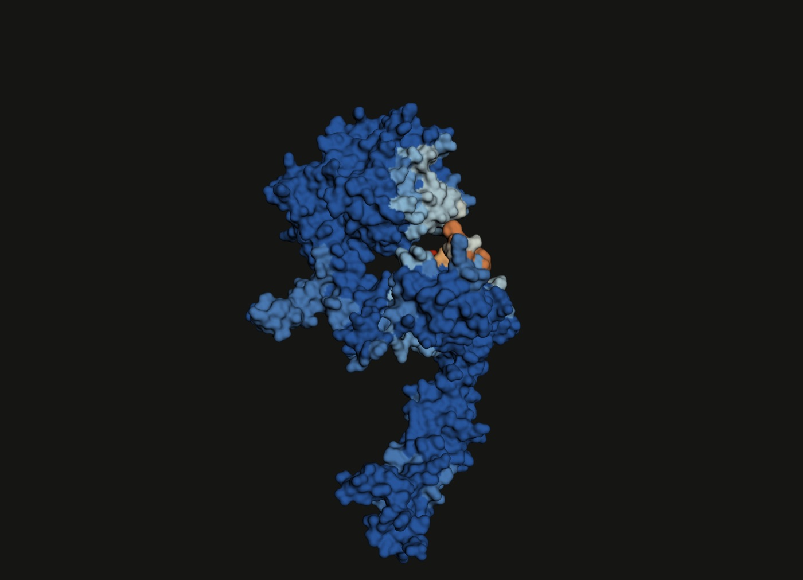
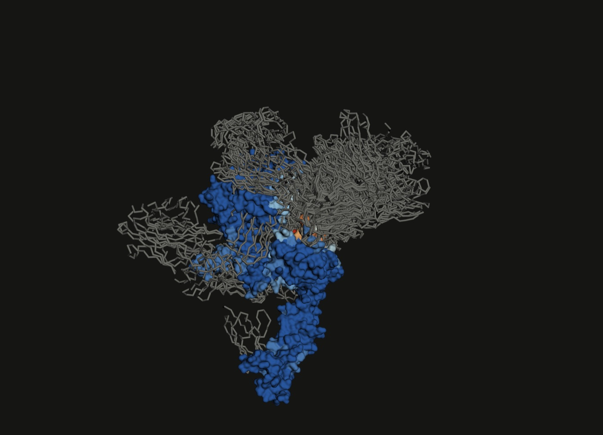

# Epitope pipeline

**Where do known binders land on a protein?**

Give this tool the ID of a target protein. It reads the published 3D structures of that
protein. It shows which antibodies and other molecules already stick to it, which parts of the
protein they touch, and whether they gather in one place more than chance would predict.

It maps where binders have been *found*. It cannot say where a new one *should* go
(see [Limits](#limits)).



*EGFR, from the saved run. Deep blue: no binder touches that part. Pale to red: more distinct
binders touch it, up to 11. The red patch is in domain III, where cetuximab, panitumumab,
necitumumab (IMC-11F8) and several other antibodies bind.*

## Quick start

You need Python 3.9 or newer. There is nothing to install.

```bash
python3 -I pipeline/run_pipeline.py --uniprot P00533 --name EGFR \
    --exclude-uniprot P04626,P21860,Q15303 \
    --domains "I=25-189,II=190-333,III=334-505,IV=506-645" --out runs/egfr
```

`P00533` is the UniProt ID of EGFR. The run reads the 57 structures that reach the outside of
the cell (about 75 MB) and takes a few seconds once they are downloaded. The EGFR run saved in
`examples/egfr` prints these lines:

```
45 complexes  ->  48 binding units  ->  20 distinct binders
of the 20: 14 antibodies and nanobodies, 2 engineered scaffolds, 4 other proteins
most-targeted patch, antibodies and nanobodies: 7 of 14 touch the sphere (radius 10 A) around residue 441 (UniProt), III
  chance: random footprints of the same sizes give a median of 3 (95th percentile 5); p = 0.01; above chance
```

`--exclude-uniprot` leaves out EGFR's close relatives: HER2, HER3 and HER4. They bind EGFR as
partners, not as drugs. `--domains` names the four domains. UniProt names none for EGFR or HER2,
so the borders are approximate ones from the structural papers (see [References](#references)).

## Words used here

- **Antigen**: the target protein.
- **Amino acid** (or **residue**): one building block of a protein. A protein is a chain of them, numbered from the start.
- **Binder**: an antibody, or another molecule, that sticks to the antigen.
- **Epitope**: the part of the antigen that a binder touches.
- **Footprint**: the epitope of one binder as this tool measures it. A residue is in it when the binder touches the residue in at least half of the binder's structures.
- **Binding unit**: one binder as it appears in one file. Many units can be the same binder.
- **Distinct binder**: one antibody (or other molecule), however many files show it.
- **Patch**: a sphere on the antigen surface, 10 Å in radius.
- **UniProt ID** (accession): the ID of a protein in [UniProt](https://www.uniprot.org/). UniProt numbers count from the first residue, signal peptide included. Papers on HER2 and EGFR count from the first residue after it: subtract 22 for HER2 and 24 for EGFR.
- **PDB**: the public store of 3D structures. Each structure has a short code, such as `1N8Z`.

## What you get

A run writes a folder with these files:

| File | What it holds |
|---|---|
| `summary.json` | the main numbers, and how far to trust them |
| `atlas-out/atlas.json` | every binder, and the amino acids of the antigen it touches |
| `atlas-out/binders.pdb` | all binders, placed in one 3D frame |
| `props.json` | for each amino acid: how exposed, how water-repelling and how buried it is |
| `target/<name>_hotspots.txt` | amino acids to aim at, ready for a design model |
| `viewer/index.html` | a 3D page for this antigen, like the picture at the top |
| `inputs.lock.json`, `inputs.snapshot.json` | the exact inputs, so you can repeat the run |
| `atlas.log` | notes from steps 3 and 4, including what was skipped and why |

To open the 3D page, start a small web server and go to http://localhost:8000. A browser
cannot read the page's data from a plain file. The page loads its 3D library from the
internet.

```bash
python3 -m http.server --directory runs/egfr/viewer
```

## More views

**Show all** places every binder on the antigen. Open `index.html?binders` to start with them
shown.



*Each binder is placed using the part of the antigen it touches, so one that binds a domain
that moved between structures still sits on that domain.*

## How it works

| Step | What happens | Script |
|---|---|---|
| 1 | Read the protein's sequence, its parts and its list of known structures from UniProt | `run_pipeline.py` |
| 2 | Download the structures from the PDB. Keep those that cover the outside of the protein, where a drug can reach, and are solved at 4 Å or better | `run_pipeline.py` |
| 3 | Line the structures up: work out how each file numbers its amino acids, then lay each binder over one reference structure | `atlas.py` |
| 4 | Count binders, not files. One antibody that appears in six files counts once. Then ask where the binders gather, and whether that beats chance | `atlas.py`, `convergence.py` |
| 5 | Measure each amino acid of the antigen, and ask whether those measures predict where binders land | `surface_props.py` |
| 6 | Write the hotspot list, a clean target file and the 3D page | `prepare_target.py`, `demo_page.py` |

Three steps are harder than they look.

**Numbering (step 3).** Structure files number their amino acids in different ways, and no
file says which way it uses. The tool works out each file's shift by matching the file's amino
acids to the protein's known sequence. A wrong shift moves every result by the same amount,
and the answer still looks sensible.

**Counting (step 4).** One antibody can appear in six files, and one file can hold two
antibodies. The tool finds antibody chains from their sequence (the end of a variable domain
carries a conserved motif), pairs each heavy chain with its light chain, and never fuses two
antibodies into one unit. It then merges units whose variable domains are at least 95% the
same, for the heavy chain and for the light chain, whatever the format: a Fab and an scFv of one
drug are one binder, and a variant with a different light chain is not. A unit that shows one
chain only joins the closest antibody with the same CDR3. On HER2, 31 binding units turn out to
be 23 distinct binders.

**Where the binders gather (step 4).** A count of binders in one place means little alone: a
footprint of 25 residues lands somewhere on a protein of 600. So the tool finds the sphere that
most binders touch (a binder touches it when at least 3 of its residues, and a quarter of them,
lie inside) and then compares the count with chance. It repeats the search 200 times with every
footprint replaced by a compact one of the same size at a random place on the exposed surface.
On EGFR, 7 of 14 antibodies and nanobodies share one sphere, in domain III. Chance gives 3
(95th percentile 5), so p = 0.01. On HER2 no sphere beats chance (4 of 18; chance gives 4): the
binders are spread over the antigen. The hotspot file is written either way, and the summary
says `hotspots_supported: false` when the patch is not above chance.

## Repeat a run exactly

Every run saves two files next to its results:

- `inputs.lock.json` lists the exact structures it used, with a fingerprint (SHA-256) of each file.
- `inputs.snapshot.json` holds the protein facts it read from UniProt and the PDB.

To repeat a run, give the lock back to the tool:

```bash
python3 -I pipeline/run_pipeline.py --from-lock examples/egfr/inputs.lock.json --out runs/egfr-replay
```

You get the same results. Once the structures are downloaded, this needs no internet. The
tool warns you if a structure file has changed.

To check that the tool still gives the same results on your machine:

```bash
./reproduce.sh
```

This repeats both examples, once with internet and once without, and compares the numbers
with the saved ones. The first run downloads about 123 MB (103 structure files). The result
files are the same on Python 3.9, 3.12, 3.13 and 3.14 on a Mac.

## Tests

```bash
python3 -I -m unittest discover -s tests       # 42 tests, no internet
./reproduce.sh && python3 -I -m unittest discover -s tests   # also runs 20 checks on the two examples
python3 -I pipeline/atlas.py --selftest        # superposition and alignment
```

The checks on the examples are the ones a structural biologist would make. Trastuzumab sits in
HER2 domain IV, pertuzumab in domain II, cetuximab in EGFR domain III. IMC-11F8 and necitumumab
are one antibody. Every binder is drawn on the antigen. Every hotspot is exposed and touched.

## Options

| Option | Meaning |
|---|---|
| `--uniprot ID` | The antigen. Needed, unless `--from-lock` is given. |
| `--name NAME` | A short name for the output files. Needed, unless `--from-lock` is given. |
| `--limit N` or `all` | How many structures to read. Default: all, unless more than 100 reach the outside of the protein, when you must choose. A number takes the first N in PDB-id order, roughly the oldest first, so the counts are then a sample. |
| `--max-resolution A` | Skip structures solved worse than this, in Å. Default 4.0. `0` keeps all. NMR entries have no resolution and are kept. |
| `--region LO-HI` | Use only structures that cover these amino acids (UniProt numbers). Default: every part outside the cell, as UniProt marks it. |
| `--exclude-uniprot A,B` | IDs of close relatives of the antigen. Their chains are partners, not drugs, so they are left out. |
| `--domains NAME=LO-HI,...` | Name the antigen's domains, in UniProt numbers. |
| `--from-lock PATH` | Repeat an earlier run exactly. |
| `--out DIR` | Where to write the results. |
| `--cache DIR` | Where to keep the downloaded structures. Default: `OUT/pdb-cache`. One folder can serve many runs. |

## Examples

`examples/` holds two finished runs, HER2 and EGFR. Each folder has the lock, the snapshot,
the summary and the log.

| | HER2 | EGFR |
|---|---|---|
| Structures listed for the protein | 63 | 388 |
| Structures that reach the outside of the cell | 49 | 57 |
| Left out: solved worse than 4 Å | 5 | 2 |
| Complexes with a binder in them | 28 | 45 |
| Binding units | 31 | 48 |
| Distinct binders | 23 | 20 |
| of them antibodies and nanobodies | 18 | 14 |
| Where the antibodies gather | nowhere above chance (4 of 18; chance 4, p = 0.81) | domain III (7 of 14; chance 3, p = 0.01) |

Both runs read every structure that reached the outside of the cell on 15 November 2026 (the
newest was released on 3 June 2026 for EGFR and 11 March 2026 for HER2).

## Checks

- **Numbering.** The shift the tool finds for each file equals the PDB's own UniProt mapping
  inside the file in 72 of 73 entries. The other has no mapping to compare.
- **Drugs against their papers.** Trastuzumab's footprint lies 100% in HER2 domain IV, pertuzumab's
  96% in domain II, cetuximab's 100% in EGFR domain III. The papers report the same domains.
- **A second way to define the epitope.** Every residue the tool calls touched (a heavy atom within 4.5 Å) also
  loses surface area when the binder is added. Against an epitope defined by buried surface, the median
  overlap (Jaccard index) over the 79 binding units is 0.82, and 0.87 for residues that lose at least 5 Ų.
  The contact epitope is a little smaller: 22 residues, against 27.
- **Repeat runs.** Both examples replay with the same result files on four Python versions, and
  a replay with the internet blocked equals the run that made the lock.

## Limits

- It reads published structures only. It shows where binders were found, not where a new one should go. A site that many structures show may only be a site that many people studied.
- An antigen must be modelled with 50 or more residues. Antibodies solved only with a short peptide (for example EGFR mAb806) are left out.
- The antigen's own ligands and receptors count as binders unless you exclude them. They are listed as "other proteins" and kept out of the patch.
- Only one copy of the antigen is read. An epitope that spans a dimer or trimer is cut short. The log says how many units this touches.
- Structures are used as deposited. Glycans are ignored, and a binder that touches the antigen only through a crystal neighbour is missed.
- Antibody chains are found by the motif that ends a variable domain. A chain without it falls back on its PDB name.

## Other scripts

`pipeline/extras/` holds helpers from the HER2 analysis. `run_pipeline.py` does not run them
and the tests do not cover them. See the note there.

## References

Structures: [RCSB PDB](https://www.rcsb.org/). Protein facts: [UniProt](https://www.uniprot.org/)
(CC BY 4.0).

Methods:

- Kyte J, Doolittle RF. A simple method for displaying the hydropathic character of a protein. *J Mol Biol* 157:105-132 (1982). The water-repelling scale.
- Tien MZ, Meyer AG, Sydykova DK, Spielman SJ, Wilke CO. Maximum allowed solvent accessibilities of residues in proteins. *PLoS ONE* 8:e80635 (2013).
- Shrake A, Rupley JA. Environment and exposure to solvent of protein atoms. Lysozyme and insulin. *J Mol Biol* 79:351-371 (1973). The surface-area method.
- Needleman SB, Wunsch CD. A general method applicable to the search for similarities in the amino acid sequence of two proteins. *J Mol Biol* 48:443-453 (1970).
- Horn BKP. Closed-form solution of absolute orientation using unit quaternions. *J Opt Soc Am A* 4:629-642 (1987). The fit of one structure onto another.

Domain borders and the drugs used as checks:

- Cho HS, et al. Structure of the extracellular region of HER2 alone and in complex with the Herceptin Fab. *Nature* 421:756-760 (2003).
- Franklin MC, et al. Insights into ErbB signaling from the structure of the ErbB2-pertuzumab complex. *Cancer Cell* 5:317-328 (2004).
- Li S, et al. Structural basis for inhibition of the epidermal growth factor receptor by cetuximab. *Cancer Cell* 7:301-311 (2005).
- Ferguson KM, et al. EGF activates its receptor by removing interactions that autoinhibit ectodomain dimerization. *Mol Cell* 11:507-517 (2003).

MIT licence. See [LICENSE](LICENSE).
