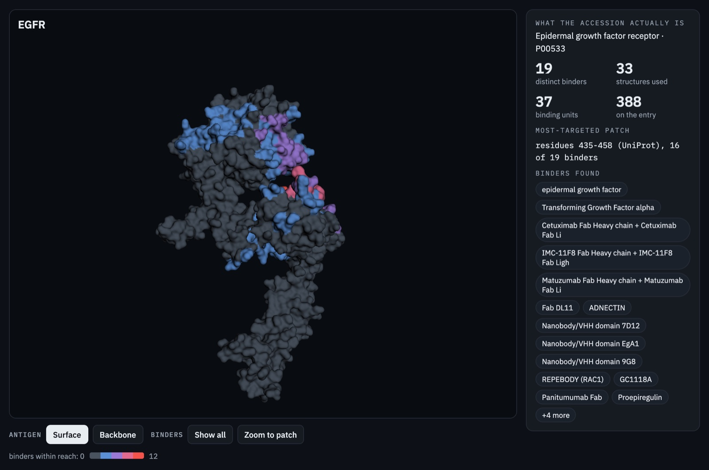
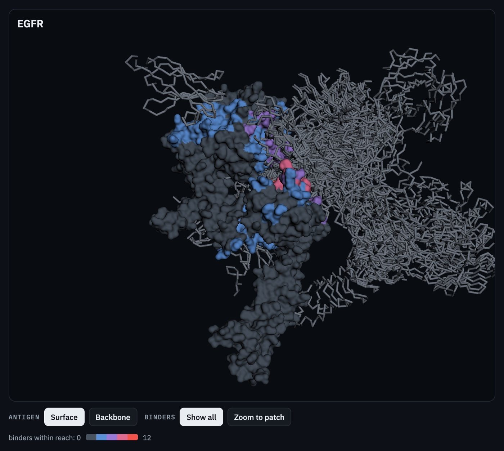
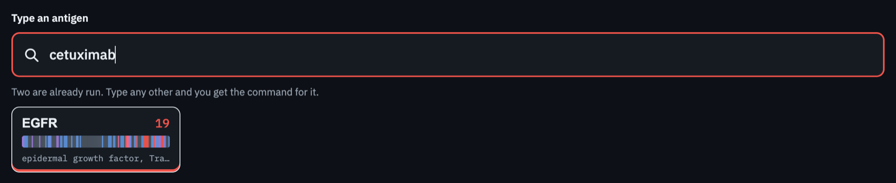

# Epitope pipeline

**Where should a new antibody bind?**

Give this tool the ID of a target protein. It reads the published 3D structures of that
protein. It shows which antibodies and other molecules already stick to it, and which parts
of the protein they touch most.



*The demo page, showing the saved EGFR run. Grey means no binder touches that part. Blue to red
means more binders do.*

## Quick start

You need Python 3.9 or newer. There is nothing to install.

```bash
python3 -I pipeline/run_pipeline.py --uniprot P00533 --name EGFR --limit 40 \
    --exclude-uniprot P04626,P21860,Q15303 --out runs/egfr
```

`P00533` is the UniProt ID of EGFR. The run reads 40 structures and takes from a few seconds
to a minute. The EGFR run saved in `examples/egfr` prints these lines:

```
33 complexes  ->  37 binding units  ->  19 distinct binders
most-targeted patch: residues 435-458 (UniProt), hit by 16 of 19 distinct binders
```

`--exclude-uniprot` leaves out EGFR's close relatives: HER2, HER3 and HER4. They bind EGFR
as partners, not as drugs.

## Words used here

- **Antigen**: the target protein.
- **Amino acid** (or **residue**): one building block of a protein. A protein is a chain of them, numbered from the start.
- **Binder**: an antibody, or another molecule, that sticks to the antigen.
- **Epitope**: the part of the antigen that a binder touches.
- **Binding unit**: one binder as it appears in one file. Many units can be the same binder.
- **UniProt ID** (accession): the ID of a protein in [UniProt](https://www.uniprot.org/).
- **PDB**: the public store of 3D structures. Each structure has a short code, such as `1N8Z`.

## What you get

A run writes a folder with these files:

| File | What it holds |
|---|---|
| `summary.json` | the main numbers |
| `atlas-out/atlas.json` | every binder, and the amino acids of the antigen it touches |
| `atlas-out/binders.pdb` | all binders, placed in one 3D frame |
| `props.json` | for each amino acid: how exposed, how water-repelling and how buried it is |
| `target/<name>_hotspots.txt` | amino acids to aim at, ready for a design model |
| `viewer/index.html` | a 3D page for this antigen, like the picture at the top |
| `inputs.lock.json`, `inputs.snapshot.json` | the exact inputs, so you can repeat the run |
| `atlas.log` | notes from step 3 and 4, including what was skipped and why |

To open the 3D page, start a small web server and go to http://localhost:8000. A browser
cannot read the page's data from a plain file. The page loads its 3D library from the
internet.

```bash
python3 -m http.server --directory runs/egfr/viewer
```

## More views

The demo page shows the two saved runs, HER2 and EGFR. **Show all** places every binder on the
antigen. The grey lines pile up where the colour is strongest.



The demo page also has a search box. You can search by antigen, by drug or by UniProt ID.
Typing `cetuximab` finds EGFR.



## How it works

| Step | What happens | Script |
|---|---|---|
| 1 | Read the protein's sequence, its parts and its list of known structures from UniProt | `run_pipeline.py` |
| 2 | Download the structures from the PDB. Keep those that cover the outside of the protein, where a drug can reach | `run_pipeline.py` |
| 3 | Line the structures up: work out how each file numbers its amino acids, then lay them all over one reference structure | `atlas.py` |
| 4 | Count binders, not files. One antibody that appears in six files counts once | `atlas.py` |
| 5 | Measure each amino acid of the antigen, and ask whether those measures predict where binders land | `surface_props.py` |
| 6 | Write the hotspot list, a clean target file and the 3D page | `prepare_target.py`, `demo_page.py` |

Two steps are harder than they look.

**Numbering (step 3).** Structure files number their amino acids in different ways, and no
file says which way it uses. The tool works out each file's shift by matching the file's amino
acids to the protein's known sequence. A wrong shift moves every result by the same amount,
and the answer still looks sensible.

**Counting (step 4).** One antibody can appear in six files, and one file can hold two
antibodies. The tool groups chains that touch each other into binding units. It then merges
units whose sequences are almost the same (95% or more). On HER2, 36 binding units turn out
to be 24 distinct binders.

## Repeat a run exactly

Every run saves two files next to its results:

- `inputs.lock.json` lists the exact structures it used, with a fingerprint (SHA-256) of each file.
- `inputs.snapshot.json` holds the protein facts it read from UniProt and the PDB.

To repeat a run, give the lock back to the tool:

```bash
python3 -I pipeline/run_pipeline.py --from-lock examples/egfr/inputs.lock.json --out runs/egfr-replay
```

You get the same results. Once the structures are downloaded, this needs no internet. The
tool warns you if a structure file has changed.

To check that the tool still gives the same results on your machine:

```bash
./reproduce.sh
```

This repeats both examples, once with internet and once without, and compares the numbers
with the saved ones. The first run downloads about 110 MB. The results are the same on
Python 3.9, 3.13 and 3.14 on a Mac, and on Python 3.12 on Linux.

A quick test of the alignment and 3D-fitting code, with no internet:

```bash
python3 -I pipeline/atlas.py --selftest
```

## Options

| Option | Meaning |
|---|---|
| `--uniprot ID` | The antigen. Needed, unless `--from-lock` is given. |
| `--name NAME` | A short name for the output files. Needed, unless `--from-lock` is given. |
| `--limit N` | How many structures to read. Default 30. It takes the first N that cover the outside of the protein. |
| `--region LO-HI` | Use only structures that cover these amino acids (UniProt numbers). Default: the part outside the cell, as UniProt marks it. |
| `--exclude-uniprot A,B` | IDs of close relatives of the antigen. Their chains are partners, not drugs, so they are left out. |
| `--from-lock PATH` | Repeat an earlier run exactly. |
| `--out DIR` | Where to write the results. |
| `--cache DIR` | Where to keep the downloaded structures. Default: `OUT/pdb-cache`. One folder can serve many runs. |

## Examples

`examples/` holds two finished runs, HER2 and EGFR. Each folder has the lock, the snapshot,
the summary and the log.

| | HER2 | EGFR |
|---|---|---|
| Structures listed for the protein | 63 | 388 |
| Structures with a binder in them | 31 | 33 |
| Binding units | 36 | 37 |
| Distinct binders | 24 | 19 |
| Most-targeted patch (UniProt numbers) | 167-190 | 435-458 |

## Other scripts

`pipeline/` also holds helpers from the HER2 analysis. `run_pipeline.py` does not run them.

- `contacts.py`: which amino acids of the antigen touch a partner chain
- `numbering.py`: how a file's numbering differs from UniProt's
- `sites.py`: rank candidate patches on one structure
- `paratope.py`: which amino acids of an antibody touch the antigen
- `format_fit.py`: the size and shape of a patch
- `pick_sites.py`: combine the evidence into site picks. It was written for the HER2 challenge and expects trastuzumab inputs.

## Limits

- It reads published structures only. It does not read papers.
- Some binders are not antibodies. On EGFR the tool also finds the protein's own growth
  factors, and lists them as "not antibody-shaped".
- The most-targeted patch is a place to start looking. It is not a final choice.

## Credits and licence

Structures: [RCSB PDB](https://www.rcsb.org/). Protein facts: [UniProt](https://www.uniprot.org/)
(CC BY 4.0). Methods: Kyte and Doolittle 1982 (water-repelling scale), Tien et al. 2013
(surface areas), and Horn's method for fitting one structure onto another.

MIT licence. See [LICENSE](LICENSE).
